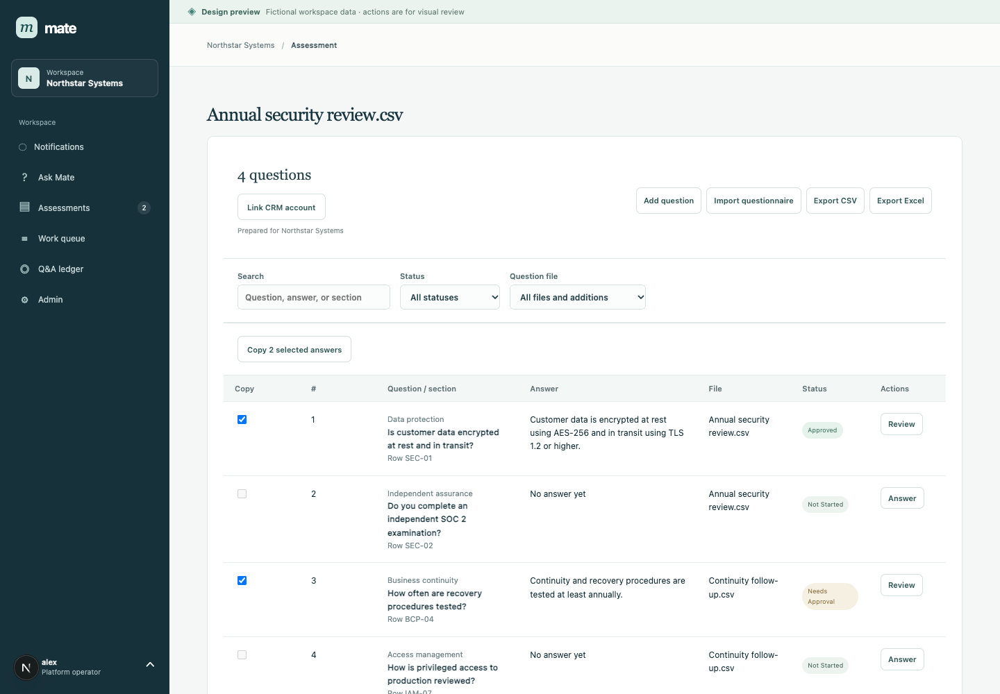

# Evidence-based review routing

An extracted, dependency-free TypeScript function from Mate. Assign a question to a reviewer only when all supporting sources resolve to one eligible owner. Missing evidence, conflicting owners, and revoked access send the item to the admin queue.

This example demonstrates the routing decision used in a larger review workflow. The calling application supplies source records and eligible owners after its authorization checks. Test identities and documents are fictional.

Requires Node 24 or later.

```sh
node --test review-routing.test.mjs
```

## Application context



This is the larger Mate application, shown with synthetic preview data. This repository contains the routing function and its tests.
